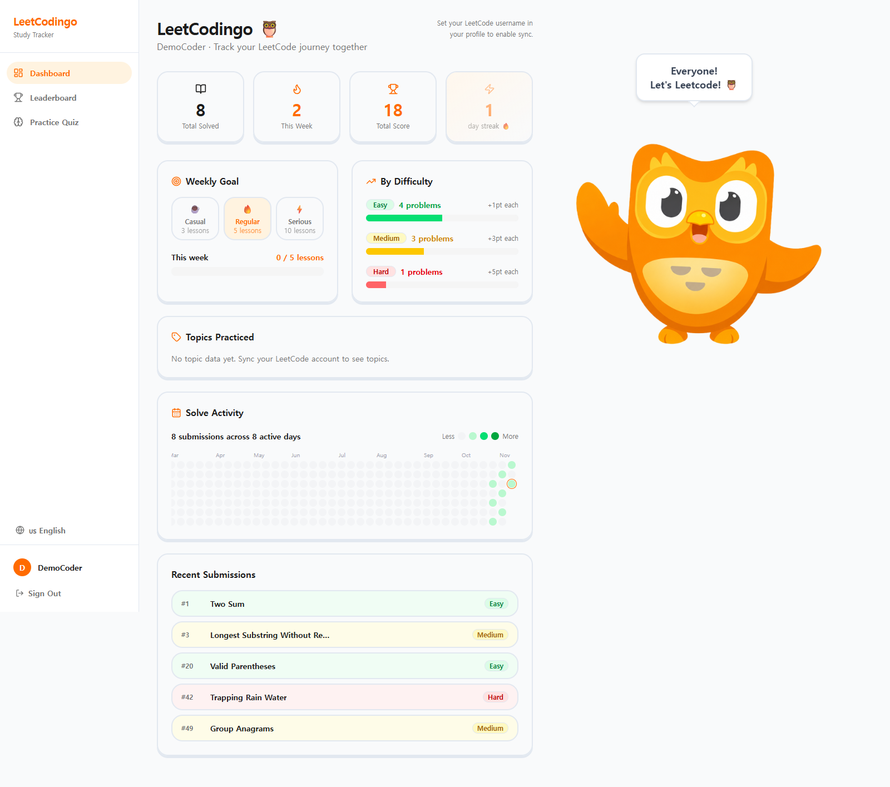
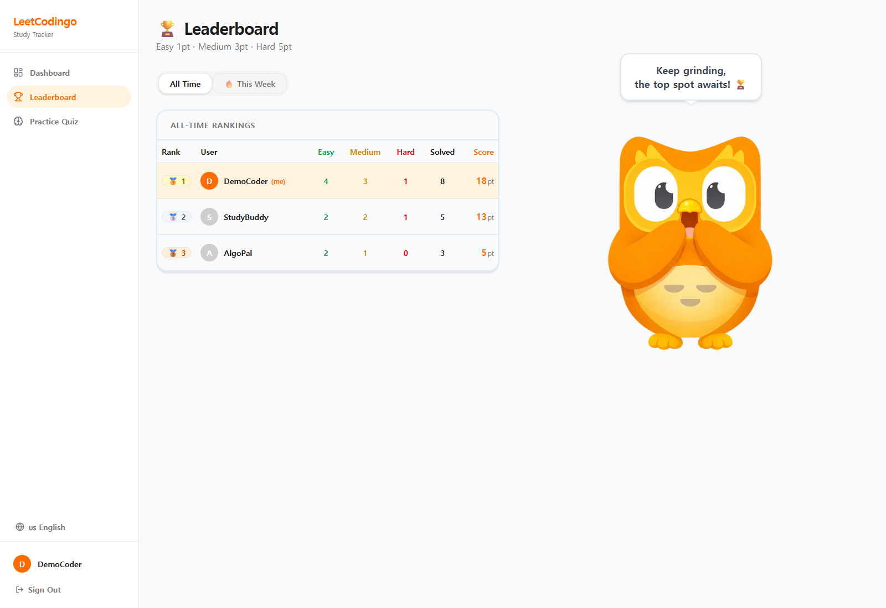
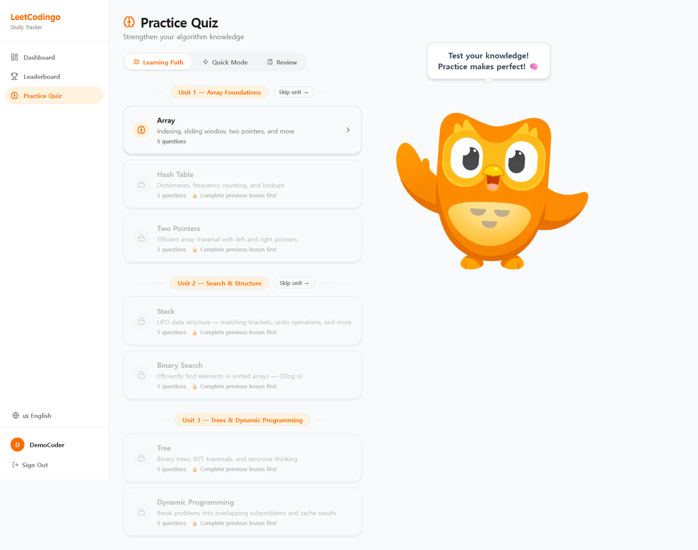

# LeetCodingo

A study tracker for friends practicing LeetCode together. Built as a personal project in 2026; demonstrated locally and not deployed.

## Screenshots

These screenshots use a separate local demo database with sample solve records and the `DemoCoder`, `StudyBuddy`, and `AlgoPal` accounts. They do not show personal account activity or a live LeetCode sync.

### Dashboard



### Leaderboard



### Quiz



## Features

- Account registration and login with BCrypt password hashing and JWT authentication.
- Manual synchronization of up to 50 recent accepted submissions through LeetCode's unofficial GraphQL API, including problem difficulty and topic tags.
- Dashboard with solve totals, difficulty and topic breakdowns, recent solves, and an activity heatmap.
- Daily check-in streaks and weekly quiz goals of 3, 5, or 10 lessons. A streak tracks app check-ins, not consecutive days of solving problems.
- All-time and weekly leaderboards: **Easy = 1**, **Medium = 3**, **Hard = 5** points.
- Seven quiz chapters: Array, Hash Table, Two Pointers, Stack, Binary Search, Tree, and Dynamic Programming. Scoring at least 80% completes a chapter and unlocks the next; the UI also offers a unit skip option.
- Fill-in-the-blank, find-the-bug, and predict-the-output questions, plus saved wrong-answer review.
- Korean, English, and Spanish interface translations; some labels and quiz content remain in English.

## Stack and structure

| Layer | Technologies |
| --- | --- |
| Frontend | React 19, TypeScript, Vite 8, React Router, Tailwind CSS 4, Base UI / shadcn components, i18next |
| Backend | C#, ASP.NET Core Web API on .NET 10, Entity Framework Core, SQLite |
| Authentication | BCrypt.Net-Next, JWT bearer authentication |
| Tests | xUnit, WebApplicationFactory, isolated temporary SQLite databases |

```text
backend/
  LeetCodingo.Api/
    Controllers/        HTTP endpoints and ownership checks
    DTOs/               API request and response contracts
    Data/               EF Core context and quiz seed data
    Models/             Users, problems, solves, tags, and quiz progress
    Migrations/         SQLite schema migrations
  LeetCodingo.Api.Tests/ Authentication and authorization integration tests
frontend/src/
  pages/                Login, registration, dashboard, leaderboard, quiz
  components/           Layout, UI primitives, mascot, activity calendar
  services/             API client and feature services
  i18n/                 Korean, English, and Spanish translations
  types/                Shared frontend types
docs/                   Screenshots and original project brief
```

## Design decisions

1. **Share problem metadata, keep progress per user.** Problems and tags form a shared catalog; submissions connect a user to a problem, while quiz progress and wrong answers belong to individual users. This avoids copying titles, difficulty, and tags for every study partner.
2. **Check for existing solves during synchronization.** The sync looks up problems by slug or LeetCode number and checks the stored `(UserId, ProblemId)` before adding a solve. Repeating a completed sync normally leaves existing solve records unchanged. This is an application-level check, not a database uniqueness guarantee: repeated items in one response and concurrent syncs still need stronger deduplication.
3. **Enforce ownership at the API boundary.** User-specific controllers inherit an `[Authorize]` base controller and compare route, query, or body user IDs with `ClaimTypes.NameIdentifier` from the validated JWT. A mismatch returns 403; requests without valid authentication return 401. Resolving a wrong answer checks its owner in the database. Public problem reads and the leaderboard remain open; user lists hide other users' emails. Accounts can only be created through password-based registration. Signing keys are configured outside source control and CORS permits only `http://localhost:5173`.

## Run locally

Install Git, **Node.js 20.19+ in the Node 20 line, or Node 22.12+** (Node 24 works), and the **.NET 10 SDK**.

```sh
git clone https://github.com/t-park5/LeetCodingo.git
cd LeetCodingo
```

### Backend

```sh
cd backend/LeetCodingo.Api
dotnet restore
```

Set a local JWT signing key once. Generate a random key rather than copying a shared example. The following works in Windows PowerShell:

```powershell
$jwtBytes = New-Object byte[] 48
$jwtGenerator = [System.Security.Cryptography.RandomNumberGenerator]::Create()
$jwtGenerator.GetBytes($jwtBytes)
$jwtGenerator.Dispose()
dotnet user-secrets set "Jwt:Key" ([Convert]::ToBase64String($jwtBytes))
```

On macOS or Linux with OpenSSL:

```sh
dotnet user-secrets set "Jwt:Key" "$(openssl rand -base64 48)"
```

Then start the API from `backend/LeetCodingo.Api`:

```sh
dotnet run --launch-profile http
```

The API listens on `http://localhost:5000`. Startup applies the checked-in EF Core migrations to create the local `leetcodingo.db` and seeds the quiz chapters. No database download or global `dotnet-ef` tool is needed. The app refuses to start without a signing key of at least 32 UTF-8 bytes. `Jwt__Key` is an alternative environment variable.

### Frontend

In another terminal, from the repository root:

```sh
cd frontend
npm install
npm run dev -- --host localhost --port 5173 --strictPort
```

Open **http://localhost:5173**, register your own account, and choose a weekly goal. A fresh database has no user accounts or solve records. An optional LeetCode username can be entered during registration; use the dashboard sync button to import recent accepted submissions.

The API URL defaults to `http://localhost:5000`. To override it, create `frontend/.env.local` with `VITE_API_URL=http://localhost:5000`. Keep the frontend origin at `http://localhost:5173` to match the development CORS policy.

If PowerShell blocks `npm.ps1`, use `npm.cmd` in place of `npm`.

### Build and test

From the repository root:

```sh
npm --prefix frontend run build
dotnet build backend/LeetCodingo.Api/LeetCodingo.Api.csproj
dotnet test backend/LeetCodingo.Api.Tests/LeetCodingo.Api.Tests.csproj
```

Stop a running API before rebuilding it on Windows to avoid executable file locks. The integration tests create their own temporary databases and test JWTs; they do not require your development signing key or modify your local study database. Coverage includes 401 responses without authentication, 403 responses for another user's data, wrong-answer ownership, successful owner writes, email privacy, public reads, and removal of passwordless account creation.

## Known limitations

- This is a local demo, not a production deployment. It has no password reset, refresh-token flow, or token revocation. JWTs expire after seven days; the frontend currently checks token presence for routing rather than proactively handling expiry.
- Tokens are stored in `localStorage`, so an XSS vulnerability could expose them.
- Server-side check-ins, imported submission timestamps, and week boundaries use UTC; weeks start on Sunday. The heatmap builds its visible date window using browser-local dates, so timezone edge cases remain.
- The dashboard initially counts all completed quiz chapters for its weekly goal; updating the goal retrieves the server's current-week count. These counts still need to be made consistent.
- LeetCode synchronization depends on an unofficial external API and imports recent accepted submissions rather than full history. New problems trigger individual metadata requests in a sequential loop; rate limiting, retries, and concurrent deduplication need improvement. Metadata failures currently fall back to Medium difficulty and problem number 0.
- Leaderboards load matching submissions and calculate groups and rankings in memory. SQL aggregation and pagination would be needed at larger scale.
- Quiz answers and scores are supplied by the client, and unit skipping can unlock chapters without an 80% result. The API does not yet provide authoritative grading or enforce learning-path prerequisites.
- NuGet reports `NU1903` for the transitive `SQLitePCLRaw.lib.e_sqlite3` 2.1.11 dependency. See [GHSA-2m69-gcr7-jv3q](https://github.com/advisories/GHSA-2m69-gcr7-jv3q). Updating the native SQLite dependency remains follow-up work before deployment.

The original scope and future ideas are in [docs/PROJECT_BRIEF.md](docs/PROJECT_BRIEF.md); planned deployment and analytics sections there describe intentions, not a live service.
